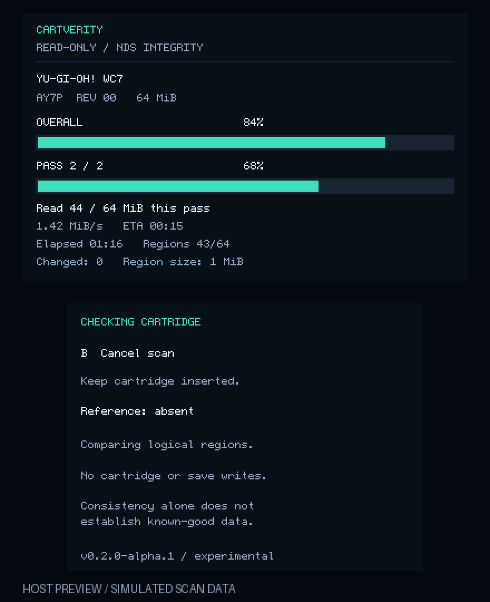

# CartVerity standalone dashboard (experimental)

This native 3DS `.firm` payload starts directly in CartVerity, with no script
listing or file browser. It is built from official GodMode9 2.2.3, commit
`0ee81b7738401b3e9f0b92b3b11159936222e542`, plus the sources in this directory.
The original `.gm9` script remains available separately.



## Install

Download the experimental native bundle from the
[v0.2.0-alpha.1 release](https://github.com/studioIV/cartverity/releases/tag/v0.2.0-alpha.1).
It includes the firmware, complete corresponding source, build environment and checksums.

On a console already running Luma3DS, copy **CartVerity.firm** to
`SD:/luma/payloads/CartVerity.firm`. Keep your working GodMode9 payload installed.
Hold START while powering on and choose CartVerity in the Luma chainloader.
Do not replace `boot.firm` or install this payload to NAND.

Insert an original standard Nintendo DS cartridge before starting. Press A to
scan, B during a scan to cancel, X at the result to cycle details. Outside a
scan, B powers off and START reboots. Finish SD writes before removing the SD.

## Dashboard and checks

- Top: overall and current-pass bars, MiB read, average MiB/s, elapsed time,
  estimated remaining time, compared and changed logical regions.
- Bottom: controls, reference state, result, two SHA-1 fingerprints, SD log path.
- Two full normalized ROM reads, reinitializing cartridge access before each
  pass. SHA-1 compares whole reads; CRC32 locates changed 1 MiB logical regions.
- Logs use unique `0:/gm9/out/dscheck/native_*.txt` names. The app checks SD
  writes, sync and close; an interrupted log lacks its final completion record.
  `state=COMPLETE` means the report finished, not that the cartridge passed.
- Optional references use the same **20 binary byte** `.nds.sha1` format and
  `gm9/support/dscheck/` filenames as the script. See the root reference guide.

Read speed includes cartridge reinitialization and drawing overhead. ETA is an
estimate. Cancellation waits for the current cartridge operation to return.
SD failures are reported separately from cartridge results. No ROM dump is saved.

## Scope and limitations

The first native version accepts standard DS cartridges up to 512 MiB and
rejects DSi-enhanced and 3DS cartridges. Special-storage compatibility is not
claimed. It does not write
cartridge ROM, save memory or NAND; only SD report files are written. This is
not a port of Cartridge Fixer's 3DS cartridge refresh operation. The native
integration explicitly bypasses upstream save-chip detection, whose EEPROM
capacity probe can otherwise write and restore a save byte. No save-chip
detection or save-memory access is needed by this app.

GodMode9 normalizes the secure area and caches some data. Reinitializing each
pass reacquires those caches but is not a physical-cell test. Its low-level DS
read interface does not expose a comprehensive per-sector fault status. The
adapter can detect initialization failures, removal and reported read failures;
it cannot certify that every electrical transfer was error-free. Consistent
reads without a trustworthy matching reference remain **unverified**. A
reference mismatch can also mean a different revision or dump representation.
SHA-1 is used for archival compatibility, not adversarial authenticity.

Native UI and scan-core tests run on a host; the ARM firmware is built in CI.
**A successful build is not a physical-console test.** The native payload is
experimental until its boot, both passes, cancellation, references and SD logs
have been checked on hardware. The supplied preview is a host rendering of the
actual C dashboard using simulated data, not a console screenshot.
The preview uses GodMode9's bundled font; upstream font/source notices are
preserved in the corresponding-source archive.

## Build and corresponding source

Requires Python 3.10+, devkitARM and firmtool. The GitHub workflow documents the
build environment. From the repository root:

```sh
python3 tools/prepare_native.py --out build/godmode9
cd build/godmode9
make firm CARTVERITY_APP=1 VERSION=CartVerity-v0.2.0-alpha.1
```

`--source-zip` allows an offline official archive; its SHA-256 must match the
pinned digest in the preparation tool. Output must be a new directory.
Copy `output/GodMode9.firm` as `CartVerity.firm`.

New CartVerity sources are MIT licensed. The **combined GodMode9-derived
firmware is GPL-3.0-or-later**, with upstream component notices retained.
Every distributed native firmware must be accompanied by its complete modified
GodMode9 source (including `license.txt`, build files, resources and CartVerity
sources). CI packages that tree **before compiling** as
`CartVerity-corresponding-source.zip`. Extract it and run the same make command
to rebuild with the documented toolchain. Do not distribute only the MIT helper
sources as corresponding source for the firmware.
